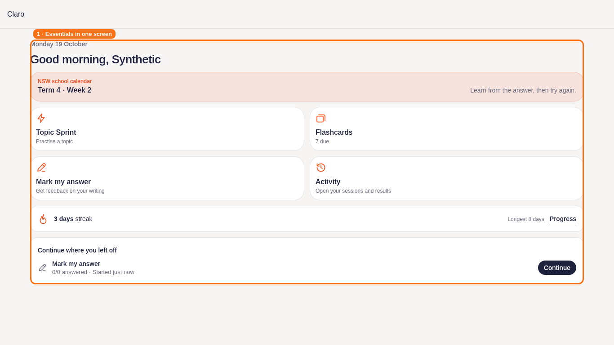
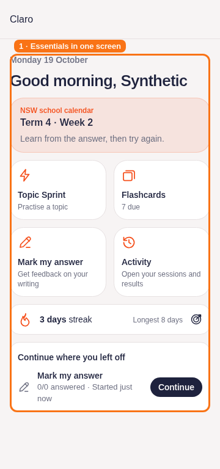
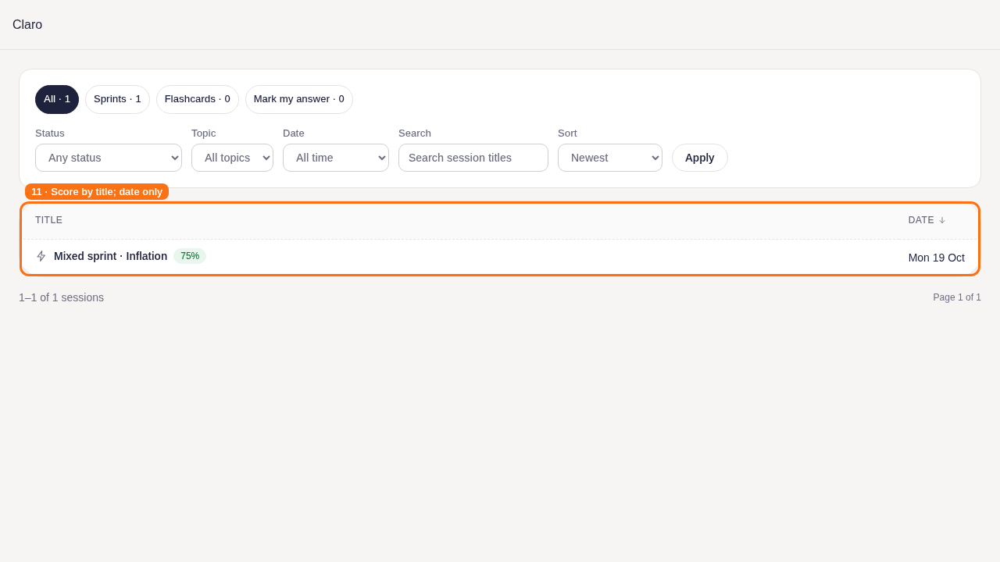
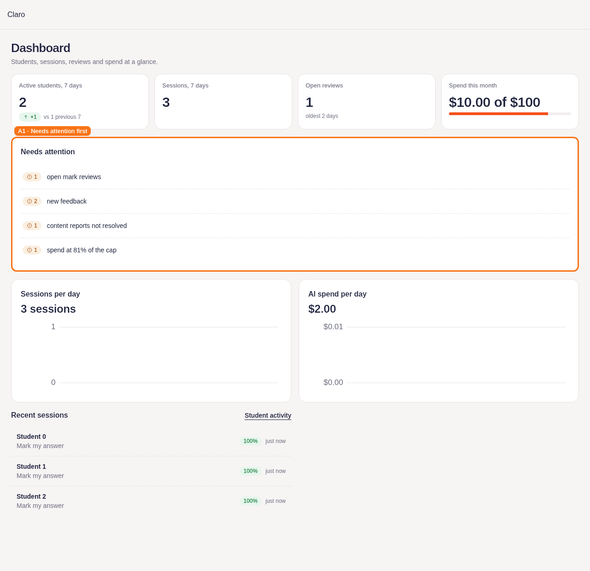
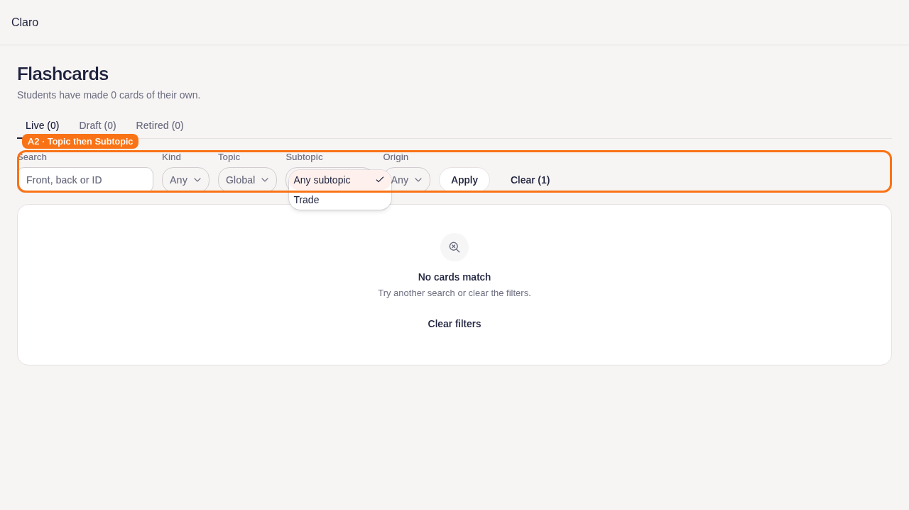

# Iteration 2 — Lane C page evidence

These are local offline Playwright screenshots of the real Lane C page/component code, with synthetic reads, app CSS, a sans-serif font fallback and a minimal header/layout. They are not production screenshots or a substitute for checking the authenticated app shell. Orange boxes and numbered labels mark the changed area. No external network, Supabase data or marking calls are used by this suite.

Run: `Q_MIN_GB=3 Q_SLOTS=1 q-run npm run test:e2e -- --config=e2e/pages.config.ts`. The suite writes its latest annotated screenshots under `/tmp/it2-pages-offline-results`; the reviewed copies below are retained with these docs.

## S1 — Home

Four study tiles, school term/week banner, due count, streak and one latest resume card. No Home score trend, history table or weak-topic section. Progress retains history and weak-topic practice. Viewport-fit assertions cover 360×768, 390×768 and 1366×768, including the shared layout's desktop bottom padding.

## S11 — Activity

The score sits with the title. Date remains visible without elapsed time; finished rows omit status. Filters, report links and newest-first default remain.

## A1 — Dashboard

Needs attention appears before charts with whole-row links. Recent sessions is capped at three links into the student's Sessions activity/report.

## A2 — Flashcard list filters

Topic lists parent topics only. Subtopic depends on Topic; switching parents clears the previous child. The add/edit/move dialogs are outside this lane's file ownership and are recorded in `LANE_NOTES.md`.

